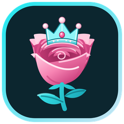

<p align="center"></p>

# Rosalena

An open source AI coding harness. It's a desktop app (Windows, macOS, Linux) with an agent loop,
tools, a local model router and a plugin system, and it lets you pick the model per chat:

- **Your own GPU.** It reads your graphics card and only offers local models that fit in your VRAM.
- **Free cloud models.** DeepSeek V4.1 Flash and GLM-5.3 Flash through free tiers, no key needed.
- **Your own keys.** DeepSeek, Kimi and Z.AI directly, plus Anthropic, OpenAI, Google Gemini and
  OpenRouter.

Download the installers at **[rosalena.dev](https://rosalena.dev/download/)**.

## What it does

- Goal mode: keeps working on one objective for up to 800 steps.
- Approval cards for anything risky, an access level per chat, undo for the last turn's file changes.
- Subagents, 14 hooks, plugins (tools and sidebar pages), MCP servers, slash-command templates.
- A local router on `127.0.0.1:8077` (OpenAI-compatible) with fallback chains, spend limits per
  provider and per-model effort levels.
- Voice typing (Whisper, on your machine), file viewer tabs, folder tabs for any folder on your PC.

## Benchmark

Same local model (Qwen3-Coder), 8 coding tasks, 2026-11-04: **Rosalena 8/8, median 67 s;
OpenCode 6/8, median 101 s.** The tasks and the runner are in [`harness/bench`](harness/bench), and
the numbers in [`harness/bench/results/summary-2026-11-04.md`](harness/bench/results/summary-2026-11-04.md).
Please rerun it and tell us if you get something different.

## Run it from source

Needs Node.js 20 or newer.

```bash
# the router (reads router/router.config.json)
cd router && node src/index.mjs

# the desktop window (Electron), in another terminal
cd desktop && npm install && npm start

# or just the web UI on http://127.0.0.1:8090
cd harness && node src/cli.mjs --ui

# tests
cd harness && node --import ./test/isolate.mjs --test
cd router && node --test
```

## Telemetry (on by default, one click to turn off)

Rosalena is built by one person, and telemetry is how bugs get found. It's on by default, the app
asks on first launch, and the switch stays in Settings > Advanced. **"Off" sends only one thing: how many
tokens your chats used on Rosalena's free cloud models** (with the random install id), so one install can't
drain the free tier everyone shares. No words, no model names, nothing about your own keys or local models.

When it's on, chats on **cloud models** send the task, the answer, the model, token counts,
errors and a short trace of each step, with API keys, tokens and passwords scrubbed out first.
Chats on **local models** never leave your computer: only numbers and the first line of an error
are sent for them. "Numbers only" sends counts, timings, models and errors, no words. The code is
in [`harness/src/telemetry.mjs`](harness/src/telemetry.mjs) and the endpoint in
[`site/functions/api/_lib/telemetry.mjs`](site/functions/api/_lib/telemetry.mjs).
`ROSALENA_TELEMETRY=off` turns it off from the environment.

## SolBrowser (included)

SolBrowser lets Rosalena read and act in your own browser, with your logins, inside embedded
frames too. It ships with Rosalena: the bundled server is in
`harness/plugins/rosa-solbrowser/vendor/bundle` and the Chrome/Brave/Edge extension in
`harness/plugins/rosa-solbrowser/vendor/extension` (load it unpacked from that folder, or download
the zip at [rosalena.dev/download/solbrowser](https://rosalena.dev/download/solbrowser/)).

## Not in this repo

- The release pipeline (it signs and publishes the installers).

## Layout

```
harness/   the agent: CLI, agent loop, tools, plugins, UI (harness/ui), tests
router/    the model router (OpenAI-compatible, 127.0.0.1:8077)
desktop/   the Electron shell
site/      rosalena.dev (Cloudflare Pages + Functions)
packaging/ installers and release tooling
docs/      design notes (INTEROP.md: how another harness talks to this one)
```

## License

MIT, see [LICENSE](LICENSE). "Rosalena" and the crowned-rose icon are the project's name and mark;
forks are welcome under their own name.
